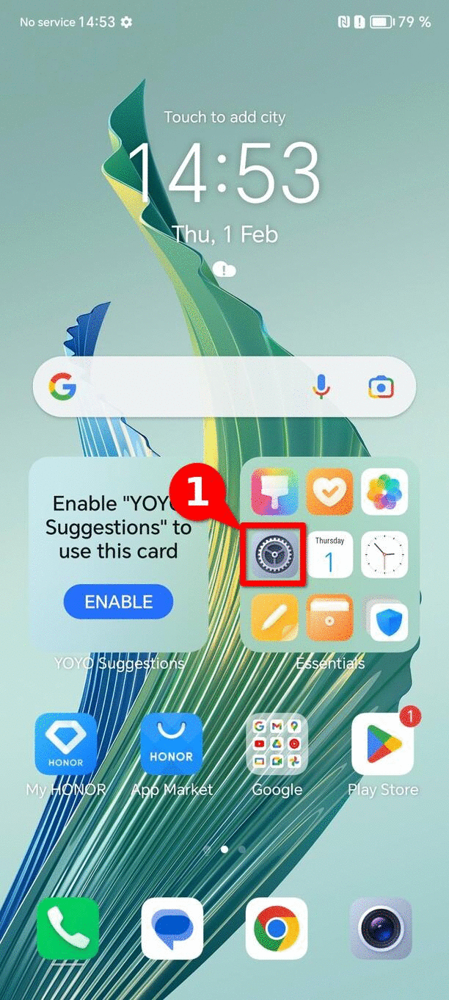
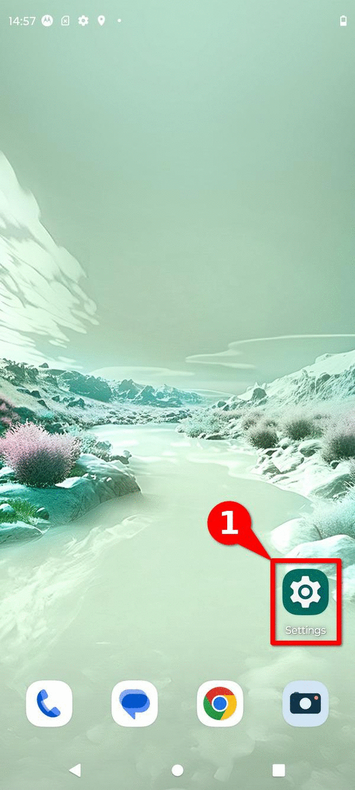
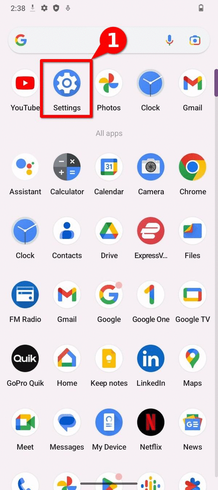
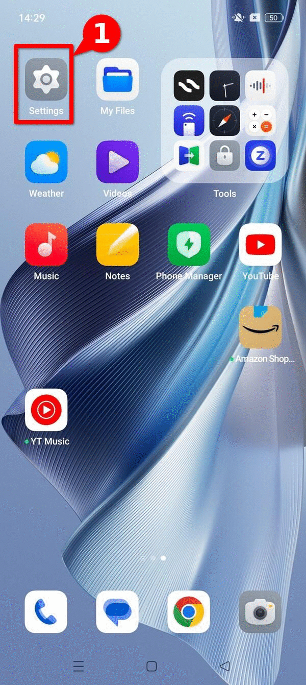
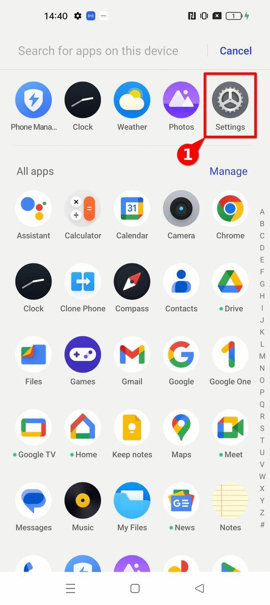
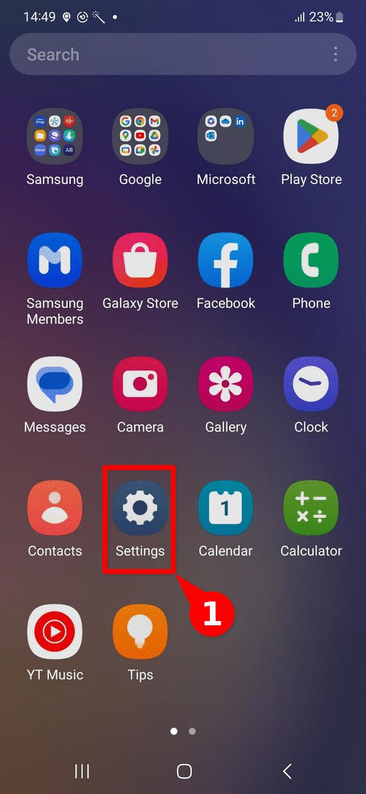
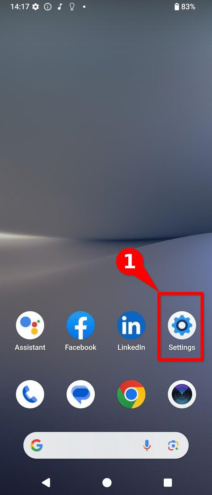
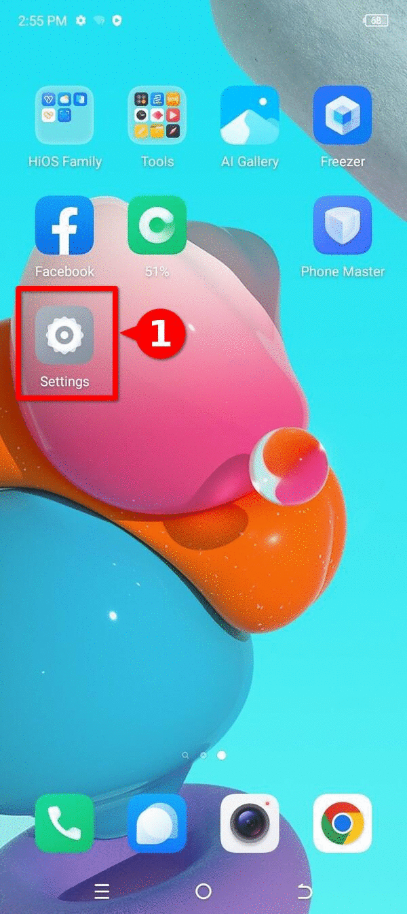
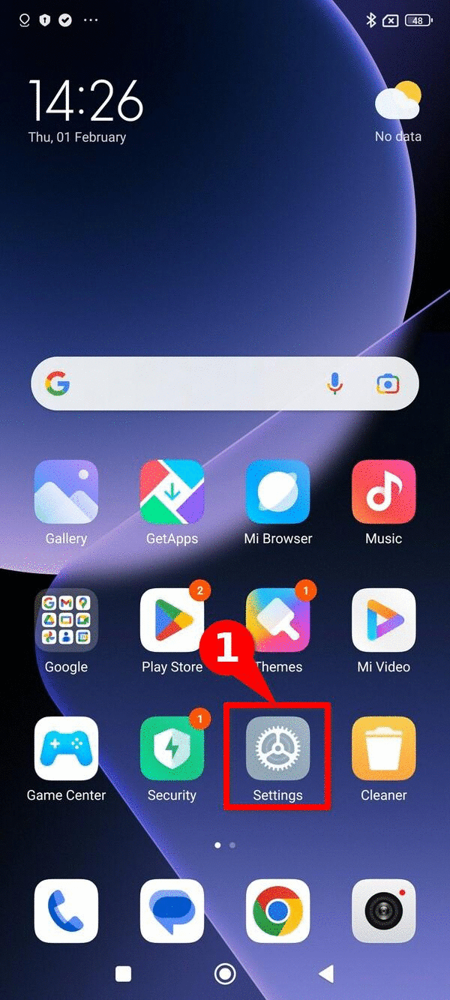

# How to enable ADB on an Android device?

This resource falls under the **[how-to guides](../)** category and **presents the steps to enable USB debugging**, also known as Android Debug Bridge or ADB, on different Android devices. It also provides a **brief explanation of what USB debugging** is and **why it is useful** in digital forensics. This is introductory material, complementary to other resources such as the [explainer on log-based forensics for Android devices](../../explainers/03-explainer-log-forensics-android/index.md) and the guide on enabling developer options, and is part of the steps to follow when making an acquisition of forensic evidence from an Android device. 

**We appreciate the collaboration of [RSF Security Lab](https://rsf.org/en/digital-security-lab)**, who provided us with a set of guides and screenshots that enabled the development of this resource. 

## What is ADB or USB debugging, and why is it useful?

ADB stands for [Android Debug Bridge](https://developer.android.com/tools/adb). It is a **command-line tool** that allows direct communication with an Android device over USB, enabling the execution of various actions and commands.

From a digital forensics perspective, particularly in log-based investigations using tools such as [AndroidQF](../../references/00-glossary/index.md#androidqf), ADB enables **establishing a direct connection with a device**. It is useful in situations where physical access to the device is available and when **the goal is to obtain information directly from the device** using native commands, without relying on additional tools. ADB or USB debugging is **also necessary to complete an extraction using AndroidQF**. 

## How to enable ADB?

In most cases, **USB debugging or ADB can be found within the Developer Options menu**. Therefore, if this menu has not yet been enabled, you should first follow the [relevant instructions for enabling it](../02-how-to-enable-developer-options/index.md).

The following section provides **step-by-step instructions for enabling ADB on different Android models** and versions.

??? question "Why is ADB enabled differently on Android devices?"

    The Android operating system is based on the [*Android Open Source Project*](https://source.android.com/)*.* However, most manufacturers [use a proprietary version developed by Google](https://www.makeuseof.com/tag/android-really-open-source-matter/), on top of which manufacturers add personalization layers. 

    [:octicons-arrow-right-24: Read more here](../02-how-to-enable-developer-options/index.md#why-are-there-different-ways-to-enable-them) 

The following section shows the steps to **enable ADB on different devices**, along with screenshots of the relevant menus for each interface.

### Google (Pixel OS) 

To enable **ADB** it is necessary to have access to the developer options menu. If you have not enabled this menu, you can **[follow these steps to enable developer options on a Pixel device](../02-how-to-enable-developer-options/index.md#google-pixel-os-generic)**, also shown on **image 1**.  

1. Open the device **Settings** ⚙️
2. Navigate to **System**
3. Navigate to **Developer Options** 🤖**
4. Enable the first option **USB debugging** 🖥️
5. **Confirm** that you want to enable USB debugging in the pop-up menu ✅

{: style="height:480px;width:216px"}
/// caption
**Image 1**. Steps to enable ADB on a Google Pixel running Android 13.
///

### Honor (Magic OS) 

To enable **ADB** it is necessary to have access to the developer options menu. If you have not enabled this menu, you can **[follow these steps to enable developer options on a Honor device](../02-how-to-enable-developer-options/index.md#honor-magic-os)**, also shown on **image 2**.  

1. Open the device **Settings** ⚙️
2. Navigate to **System and Updates**
3. Navigate to **Developer Options** 🤖**
4. Enable the first option **USB debugging** 🖥️
5. **Confirm** that you want to enable USB debugging in the pop-up menu ✅

{: style="height:480px;width:216px"}
/// caption
**Image 2**. Steps to enable ADB on a Honor Magic Lite running Magic OS 7.1 and Android 13.
///

### Motorola (Hello UI)

To enable **ADB** it is necessary to have access to the developer options menu. If you have not enabled this menu, you can **[follow these steps to enable developer options on a Motorola device](../02-how-to-enable-developer-options/index.md#motorola-hello-ui)**, also shown on **image 3**.  

1. Open the device **Settings** ⚙️
2. Navigate to **System**
3. Navigate to **Developer Options** 🤖**
4. Enable the first option **USB debugging** 🖥️
5. **Confirm** that you want to enable USB debugging in the pop-up menu ✅

{: style="height:480px;width:216px"}
/// caption
**Image 3**. Steps to enable ADB on a Motorola Edge Neo 40 running Hello UI and Android 13.
///

### Nokia  

To enable **ADB** it is necessary to have access to the developer options menu. If you have not enabled this menu, you can **[follow these steps to enable developer options on a Nokia device](../02-how-to-enable-developer-options/index.md#nokia)**, also shown on **image 4**.  

1. Open the device **Settings** ⚙️
2. Navigate to **System**
3. Navigate to **Developer Options** 🤖**
4. Enable the first option **USB debugging** 🖥️
5. **Confirm** that you want to enable USB debugging in the pop-up menu ✅

{: style="height:480px;width:216px"}
/// caption
**Image 4**.  Steps to enable ADB on a Nokia G42 5G running Android 13.
///

### Oppo Reno 10 (Color OS)

To enable **ADB** it is necessary to have access to the developer options menu. If you have not enabled this menu, you can **[follow these steps to enable developer options on a OPPO device](../02-how-to-enable-developer-options/index.md#oppo-reno-10-color-os)**, also shown on **image 5**.
  
1. Open the device **Settings** ⚙️
2. Navigate to **Additional Settings**
3. Navigate to **Developer Options** 🤖**
4. Enable the first option **USB debugging** 🖥️
5. **Confirm** that you want to enable USB debugging in the pop-up menu ✅

{: style="height:480px;width:216px"}
/// caption
**Image 5**. Steps to enable ADB on an Oppo device.
///

### Realme (Realme UI)

To enable **ADB** it is necessary to have access to the developer options menu. If you have not enabled this menu, you can **[follow these steps to enable developer options on a Realme device](../02-how-to-enable-developer-options/index.md#realme-realme-ui)**, also shown on **image 6**.  

1. Open the device **Settings** ⚙️
2. Navigate to **Additional Settings**
3. Navigate to **Developer Options** 🤖**
4. Enable the first option **USB debugging** 🖥️
5. **Confirm** that you want to enable USB debugging in the pop-up menu ✅

{: style="height:480px;width:216px"}
/// caption
**Image 6**. Steps to enable ADB on a Realme GT2 Pro with RealMe UI 4.0 and Android 13
///

### Samsung (One UI)

To enable **ADB** it is necessary to have access to the developer options menu. If you have not enabled this menu, you can **[follow these steps to enable developer options on a Samsung device](../02-how-to-enable-developer-options/index.md#samsung-one-ui)**, also shown on **image 7**.  

1. Open the device **Settings** ⚙️
2. Navigate to **Developer Options** 🤖**
3. Enable the first option **USB debugging** 🖥️
4. **Confirm** that you want to enable USB debugging in the pop-up menu ✅

{: style="height:480px;width:216px"}
/// caption
**Image 7**. Steps to enable ADB on a Samsung Galaxy A54 with One UI and Android 13
///

### Sony (Xperia UI)

To enable **ADB** it is necessary to have access to the developer options menu. If you have not enabled this menu, you can **[follow these steps to enable developer options on a Sony device](../02-how-to-enable-developer-options/index.md#sony-xperia-ui)**, also shown on **image 8**.  

1. Open the device **Settings** ⚙️
2. Navigate to **System**
3. Navigate to **Developer Options** 🤖**
4. Enable the first option **USB debugging** 🖥️
5. **Confirm** that you want to enable USB debugging in the pop-up menu ✅

{: style="height:480px;width:216px"}
/// caption
**Image 8**.  Steps to enable ADB on a Sony Xperia 10V with Xperia UI 4.0 and Android 14.
///

### Tecno (Hi OS)

To enable **ADB** it is necessary to have access to the developer options menu. If you have not enabled this menu, you can **[follow these steps to enable developer options on a Tecno Spark device](../02-how-to-enable-developer-options/index.md#tecno-hi-os)**, also shown on **image 9**.  

1. Open the device **Settings** ⚙️
2. Navigate to **System**
3. Navigate to **Developer Options** 🤖**
4. Enable the first option **USB debugging** 🖥️
5. **Confirm** that you want to enable USB debugging in the pop-up menu ✅

{: style="height:480px;width:216px"}
/// caption
**Image 9**.  Steps to enable ADB on a Tecno Spark Go with Hi OS and Android 13.
///

### Xiaomi (Hyper OS)

To enable **ADB** it is necessary to have access to the developer options menu. If you have not enabled this menu, you can **[follow these steps to enable developer options on a Xiaomi device](../02-how-to-enable-developer-options/index.md#xiaomi-hyper-os)**, also shown on **image 10**.  

1. Open the device **Settings** ⚙️
2. Navigate to **Additional Settings**
3. Navigate to **Developer Options** 🤖
4. Enable the first option **USB debugging** 🖥️
5. **Confirm** that you want to enable USB debugging in the pop-up menu ✅

{: style="height:480px;width:216px"}
/// caption
**Image 10**.  Steps to enable ADB on a Xiaomi device.
///

### Other devices
	
If your device is not listed above, **USB debugging** is usually the first option inside the **Developer Options** menu. You can also type **USB debugging** in the search bar of the **Settings** menu to find it.

## How to disable ADB?
	
Once the acquisition is finished, it is a good practice to **disable USB debugging**, so that the device returns to its original state. To do so, follow these steps:
	
1. Open the **Developer Options** menu, in the same location used to enable USB debugging 🤖
2. **Turn off** the option **USB debugging** ⛔
	
If you no longer need the developer options menu, you can also [disable developer options](../02-how-to-enable-developer-options/index.md#how-to-disable-developer-options), which turns off USB debugging as well.

## Conclusion

**ADB**, or Android Debug Bridge, is a **native Android command-line tool that allows direct interaction with a device**. In forensic analysis contexts, it can be useful for obtaining information that supports triage without the need for third-party tools.

Due to the wide variety of manufacturers and Android operating system versions, this guide presents a **list of manufacturers and step-by-step instructions to enable ADB**, helping facilitate and promote consent-based forensic analysis in support of civil society.

If you have access to a **graphical interface not shown in this list** and would like to **contribute** a screenshot to this resource, you can contact us through an [issue](../../community/how-to-contribute/index.md#reporting-issues) or, if you are comfortable with markdown, submit a [pull request](../../community/how-to-contribute/index.md#integrating-new-content-through-pull-requests).

## Comments

Do you have any **comment or suggestion** about this resource? You can use the **comment function provided below** to leave your ideas, corrections or thoughts. Please make sure to follow our [code of conduct](../../community/code-of-conduct/) when leaving your comment. If you prefer, you can also participate in the discussion directly in the [github repository](https://github.com/Socialtic/forensics/discussions). 
